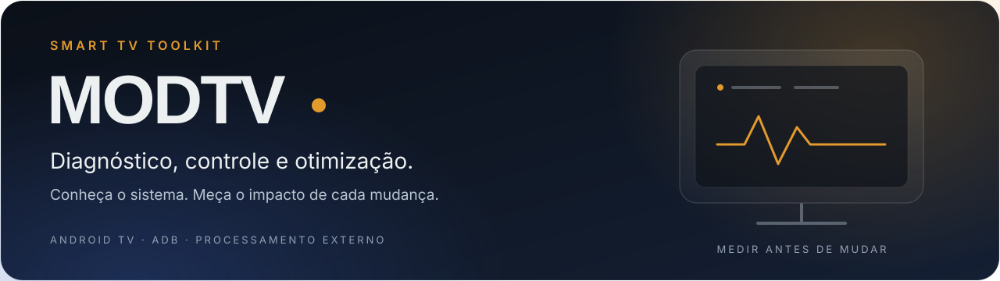

<p align="center">
  
</p>

<p align="center">
  <a href="https://developer.android.com/tv"></a>
  <a href="https://www.python.org/"></a>
  <a href="https://openjdk.org/"></a>
  <a href="https://learn.microsoft.com/powershell/"></a>
  <a href="https://developer.android.com/tools/adb"></a>
  <a href="https://ffmpeg.org/"></a>
</p>

<p align="center">
  <a href="#o-projeto">Projeto</a> &nbsp;·&nbsp;
  <a href="#primeiros-passos">Primeiros passos</a> &nbsp;·&nbsp;
  <a href="#resultados-medidos">Resultados</a> &nbsp;·&nbsp;
  <a href="#reversão-como-parte-do-projeto">Reversão</a> &nbsp;·&nbsp;
  <a href="#documentação">Documentação</a>
</p>

# MODTV

**Ferramentas para entender, administrar e melhorar uma Smart TV Android.**

O MODTV reúne diagnóstico via ADB, análise de desempenho, otimizações reversíveis,
automação e uma interface própria para uso diário. O trabalho começou em uma
TCL com Android TV 12; o projeto registra o que foi observado nesse equipamento,
sem presumir compatibilidade com qualquer TV.

O launcher **lume** e a galeria **Paisagens** fazem parte desse conjunto.
O escopo vai além da tela inicial: investigar o sistema, medir mudanças e manter
um caminho de recuperação para cada intervenção.

## O projeto

Uma TV tem recursos limitados. Coletar métricas, preparar mídia e analisar os
resultados no computador permite investigar o sistema sem instalar um agente
permanente de monitoramento no aparelho.

```text
Computador                                  Android TV
─────────────────────────────               ─────────────────────────
Python · PowerShell · FFmpeg      ADB        Diagnóstico do sistema
Coleta, análise e preparação  ◀──────────▶   Apps, serviços e display
Relatórios e recuperação                     lume · Paisagens
```

| Frente | Implementação atual |
|---|---|
| **Diagnóstico** | Consultas de sistema, pacotes, CPU, memória, temperatura, tela e reprodução |
| **Desempenho** | Séries temporais, comparação de launchers e análise de quadros atrasados |
| **Administração** | Intervenções ADB registradas, com estado anterior, impacto e reversão |
| **Launcher** | lume em Java, com navegação por controle, apps, entradas e acesso às Configurações |
| **Paisagens** | Fotos locais, troca automática, legenda, relógio, escurecimento e protetor de tela |
| **Mídia UHD** | Preparação no PC de JPEGs e clipes HEVC para o plano de vídeo da TV |
| **Recuperação** | Prévia e executor de reversão, inventário de alterações e cópia do conteúdo externo do app |

Painel de monitoramento, integrações com Home Assistant/MQTT e suporte a mais
modelos estão no horizonte do projeto. **Ainda não são recursos entregues.**

## Método de trabalho

**Descobrir → medir → planejar → alterar → validar → documentar.**

- Uma hipótese de hardware continua sendo hipótese até ser confirmada.
- A mesma condição de teste deve ser usada para comparar antes e depois.
- Menor consumo de memória não comprova melhor fluidez ou menor consumo elétrico.
- Alterações persistentes precisam de estado anterior e procedimento de recuperação.
- Diagnóstico, automação com teclas e comandos que alteram o sistema são operações diferentes.

## A interface: lume

O lume traz uma tela inicial com foco em conteúdo local e acesso direto aos apps.
Sua identidade combina superfícies escuras, luz âmbar, vidro discreto e espaço
para leitura à distância. O controle remoto orienta a navegação.

| Escolha de design | Aplicação |
|---|---|
| **Hierarquia** | Tipografia proporcional, títulos claros e ações principais fáceis de localizar |
| **Ritmo** | Espaçamento consistente e separação entre navegação, conteúdo e estado |
| **Contraste** | Fundo breu, texto névoa e âmbar para foco e destaque |
| **Movimento** | Transições curtas; o modo estático evita redesenho contínuo em repouso |
| **Tipografia** | Sora e Inter, com arquivos de licença preservados no projeto |

### Paisagens

A galeria usa fotos locais e prepara a mídia no computador. Quando o caminho de
vídeo funciona, um clipe HEVC UHD é pausado após a exibição inicial para manter a
imagem; há fallback para JPEG em 1080p. Entre as trocas, o app evita animação contínua.

**Buffer UHD e resolução física do painel são verificações diferentes.** No
equipamento testado, o decodificador e o buffer 3840×2160 foram confirmados. A
resolução física integral a 120 Hz permanece sem comprovação. A interface Android
continua renderizada em 1920×1080.

Detalhes de operação, créditos e limitações estão no [guia Paisagens](docs/paisagens.md).

## Resultados medidos

Comparação local realizada em **25/10/2026**, com os mesmos ajustes de tela:
duas rodadas por launcher, em ordem Google/lume/lume/Google, com cerca de
32 segundos de repouso e 20 segundos de navegação por rodada.

| Métrica | Google TV | lume |
|---|---:|---:|
| PSS dos processos do launcher | 154,94 MB | **59,03 MB** |
| CPU em repouso, em % de um núcleo | 6,77% | **0,00% na resolução amostral** |
| Redesenho em repouso | 3,08 quadros/s | **0,00 quadros/s nas janelas medidas** |
| Quadros atrasados na navegação | **1,44%** | 6,76% |

O lume utilizou aproximadamente **62% menos memória nos processos do launcher**.
O Google TV teve menos quadros atrasados durante a navegação. A economia em
repouso foi medida; superioridade geral de fluidez e economia elétrica não foram
demonstradas. A memória disponível total subiu cerca de 43 MB nessa comparação,
pois o Google TV ainda mantinha processos em segundo plano.

A galeria e o protetor também concluíram coletas separadas de 20 minutos, com
41 amostras válidas cada, sem alertas térmicos nas leituras. A exibição física
das fotos e o retorno ao lume pelo botão Home foram confirmados pelo usuário.
Esses testes não substituem validação prolongada ou em outros modelos.

Consulte a [metodologia, os limites e a configuração do launcher](docs/launcher-padrao.md).

## Tecnologias

| Tecnologia | Papel no projeto |
|---|---|
| **Python** | Coleta, processamento de métricas, preparação de mídia e reversão |
| **Java / Android SDK** | Launcher, galeria, desenho da interface e integração com Android TV |
| **PowerShell** | Compilação local no Windows e envio de conteúdo |
| **ADB / Android Shell** | Comunicação autorizada, inspeção e administração do equipamento |
| **FFmpeg / FFprobe** | Conversão e validação de imagens e clipes HEVC UHD |
| **CSV / JSON / Markdown** | Métricas, metadados de mídia, planos e documentação |

O launcher é compilado com `aapt2`, `javac`, `d8`, `zipalign` e `apksigner`, sem
Gradle no fluxo atual. O manifesto define Android 12/API 31 como mínimo e API 34
como alvo. A versão local do app é **2.1.1-lume-paisagens**.

## Primeiros passos

### 1. Preparar o ambiente

- Computador com Python 3.11 ou superior e Android SDK Platform Tools no `PATH`.
- TV compatível, na mesma rede, com depuração habilitada e conexão autorizada no aparelho.
- FFmpeg e FFprobe no `PATH` para preparar novas paisagens.
- Para compilar o launcher: Android SDK, Build Tools e JDK. O script atual usa
  as variáveis ANDROID_HOME (ou ANDROID_SDK_ROOT) e JAVA_HOME do seu ambiente.

O executor de reversão valida o device **G09**, e as ferramentas existentes
ainda precisam de validação fora do ambiente original. A portabilidade para outros
equipamentos e computadores ainda exige adaptação.

### 2. Conectar à TV

Execute os exemplos a partir da raiz do projeto. Informe o endereço real da sua
TV; sempre use um serial explícito para não atingir outro dispositivo ou emulador.

```powershell
$tv = Read-Host "Endereço ADB autorizado da TV, no formato IP:porta"
adb connect $tv
adb devices -l
```

### 3. Fazer uma coleta somente leitura

```powershell
$saida = "reports/observacao-$(Get-Date -Format yyyyMMdd-HHmmss)"
python tools/validate_paisagens.py --serial $tv --minutes 1 --interval 10 --out $saida
```

Essa coleta consulta CPU, memória, temperatura, primeiro plano e player.
Não abre apps, envia teclas, reinicia contadores ou modifica configurações na TV.
O relatório é incremental; confirme o estado **concluído** antes de tratar a
duração solicitada como uma medição terminada.

### 4. Inspecionar um plano de reversão

```powershell
python tools/revert_modtv.py --serial $tv --profile full
```

Sem `--apply`, o comando apenas consulta o estado e grava o plano no computador.
A execução deve seguir o [guia completo de reversão](docs/REVERSAO-COMPLETA.md).
Não há um comando genérico de desativação de pacotes recomendado para outras TVs.

## Reversão como parte do projeto

O retorno ao estado anterior é preparado junto com a intervenção.

| Perfil | Escopo |
|---|---|
| `home` | Google TV, configuração inicial, seleção HOME e protetor original |
| `full` | Perfil `home`, pacotes dos grupos registrados, Assistente/voz, remoção dos overrides de refresh e desativação do lume sem apagar dados |

O executor exige `--apply` para alterar a TV, faz backup externo/APK e verifica
o HOME original antes de desativar o lume. A prévia foi validada; a reversão real
completa ainda não foi executada no aparelho.

Há limites documentados: dados antigos do Plex desinstalado não têm backup conhecido,
e as preferências privadas do lume não estão na cópia externa. Reversão funcional
não equivale a uma imagem integral de fábrica. Os pacotes já desativados antes do
projeto não são reativados automaticamente.

## Estrutura

```text
.
├── launcher/
│   ├── src/                  # lume, galeria e protetor em Java
│   ├── assets/fonts/         # Sora, Inter e respectivas licenças
│   ├── paisagens/            # Coleções, originais e créditos
│   ├── AndroidManifest.xml
│   └── build.ps1
├── tools/                    # Diagnóstico, comparação, mídia e reversão
├── docs/                     # Guias, histórico e recuperação
│   └── assets/               # Identidade visual da documentação
├── reports/                  # Evidências e backups do ambiente local
├── AGENTS.md                 # Diretrizes e continuidade do projeto
└── README.md
```

Os relatórios locais podem conter informações do aparelho e da rede. Eles são
material de diagnóstico e precisam ser revisados antes de qualquer compartilhamento.

## Testes locais

Os testes abaixo não precisam de uma TV e não executam a reversão:

```powershell
python -m unittest discover -s tools -p "test_*.py" -v
```

As verificações cobrem cálculo de CPU, dados ausentes, identificação do player,
ordem de recuperação do HOME e proteção contra comandos destrutivos nos planos.
Comparar launchers ou validar funções físicas exige o equipamento conectado;
os scripts de comparação abrem telas, enviam D-pad e podem reiniciar contadores
de renderização. Leia a descrição de cada ferramenta antes de executar.

## Documentação

| Documento | Conteúdo |
|---|---|
| [Diretrizes do projeto](AGENTS.md) | Objetivos, restrições e continuidade |
| [Histórico de intervenções](docs/intervencoes.md) | Ações, autorizações, resultados e recuperação |
| [Launcher padrão e comparação](docs/launcher-padrao.md) | Configuração, métricas e limites observados |
| [Paisagens](docs/paisagens.md) | Galeria, plano de vídeo UHD, operação e créditos |
| [Reversão completa](docs/REVERSAO-COMPLETA.md) | Escopo de recuperação, executor e etapas manuais |

## Desenvolvimento

Há trabalho a fazer na fluidez da navegação do lume, na configuração dos caminhos
de ferramentas, na adaptação a outros dispositivos e na observação em uso prolongado.
Mudanças devem informar o cenário testado, o efeito observado e a forma de desfazer.
Resultados de uma TCL não devem ser apresentados como garantia para todo Android TV.

## Licenças e créditos

O código do projeto **ainda não possui uma licença de distribuição definida neste
checkout**. As fontes Sora e Inter têm seus termos em [assets/fonts](launcher/assets/fonts/).
As fotografias têm licenças e autores próprios, registrados nos
[créditos da coleção](launcher/paisagens/colecao/CREDITOS.md).

Android, Google TV e TCL são marcas de seus respectivos titulares. Este é um
projeto independente, sem vínculo oficial com esses fabricantes.
